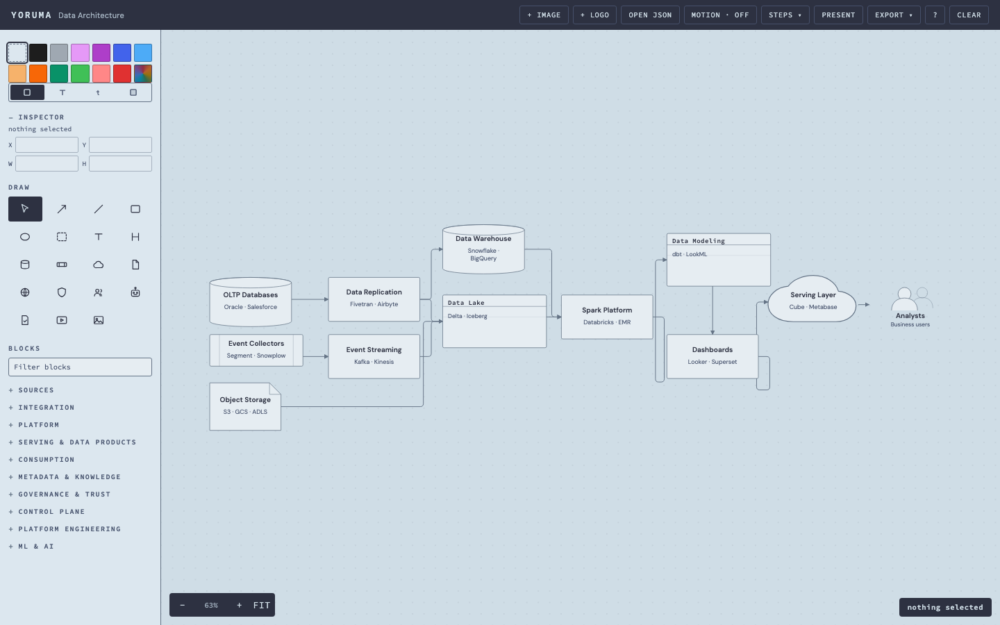
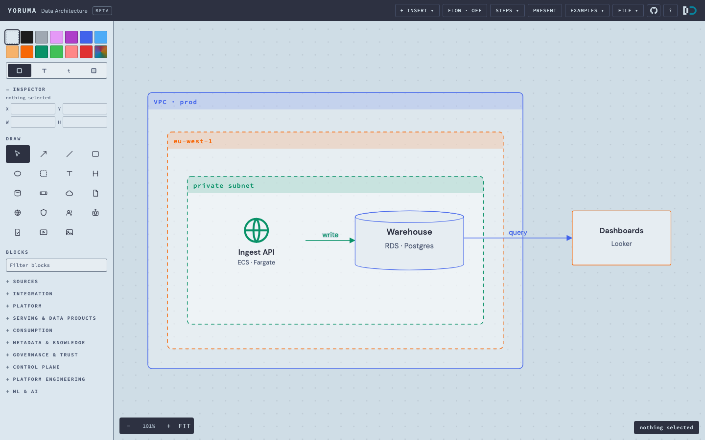
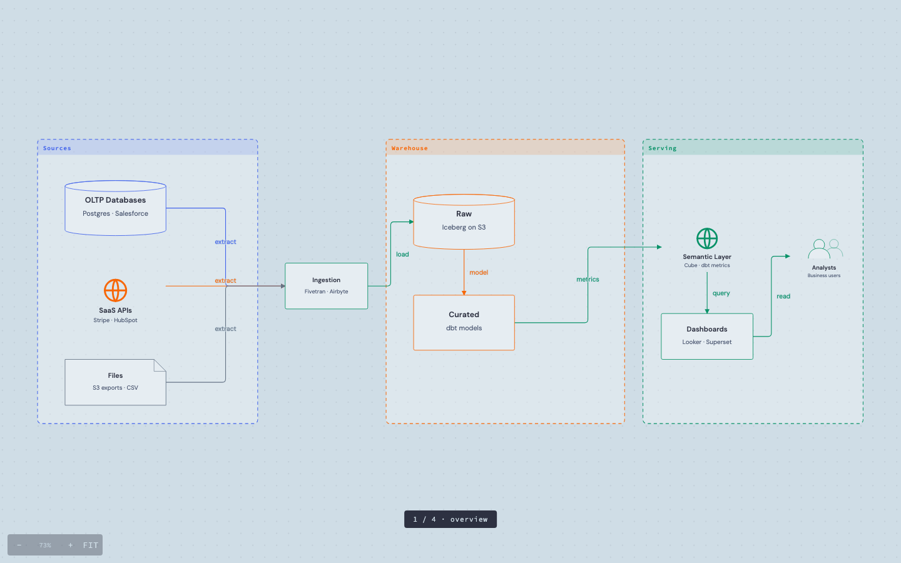

# yoruma — data diagrams

yoruma draws data diagrams. It runs as one static page.
Nothing to install. There is no build step.

**Use it:** <https://soyomarvaldezg.github.io/yoruma/> — or open `index.html` from a clone.

The page starts on a blank canvas. Press **EXAMPLES ▾** to load a sample:
a BI stack, a streaming pipeline, or an ML platform.



**yoruma is beta.** It is a work in progress. Expect rough edges:
a gesture that behaves oddly, an export that misses a detail.
The test suite runs on every push. The document format is versioned.
Nothing here is a promise. Download a JSON copy of work you cannot lose.

## The screen

```
┌─────────────────────────────────────────────────────────────────┐
│ header          │IMAGE  FLOW  STEPS  PRESENT  EXAMPLES  FILE    │
├─────────────────┬───────────────────────────────────────────────┤
│ left panel      │ canvas                                        │
│  Draw           │  shapes, zones and arrows                     │
│  Icons          │                                               │
│  Blocks         │   ┌─ style bar ──────────┐                    │
│                 │   │ swatches · stroke    │                    │
│                 │   │ fill · edges · width │                    │
│                 │   └──────────────────────┘                    │
│                 │                                               │
│                 │  status line       −  100%  +  FIT            │
└─────────────────┴───────────────────────────────────────────────┘
```

The left panel holds the tools, the icons and the Blocks palette.
Press **⌘.** to hide the panel. Press **⌘.** again to show it.

The style bar appears when you select a shape. It stays top-right.

## What you can draw

- **Zones** hold other shapes. A zone carries every shape inside it, at any depth.
  Move a zone and its shapes move with it. Resize a zone and the shapes stay in place.
  A zone can show a header band. Set `solid` to remove its dashes.
- **Cards** are boxes with a title and an optional subtitle.
  A card takes its own stroke colour and its own fill.
  It can carry an icon or a brand logo.
- **Arrows** attach anywhere on a border. They enter the border at a right angle.
  Bend an arrow, style it, animate it, or give it a note.
- **Pages** hold separate diagrams in one document.
  The page strip sits at the top-left of the canvas.
  Click a page to open it. Double-click to rename it. Click `×` to delete it.
  Each page keeps its own shapes, arrows and zoom.
- **Steps** are invisible frames. Select shapes and add a step.
  Then **PRESENT** walks from the overview through each step.
  Everything outside the current step dims.



## Shape style

The style bar has four paint targets: **stroke**, **fill**, **title** and **note**.
Click a target. Then click a swatch. The swatch paints that target.
Drag a swatch onto a shape to paint it directly.

The rows below the swatches change the shape itself:

| Row | Values | What it does |
|---|---|---|
| Stroke | solid · dashed · dotted | Changes the outline pattern |
| Edges | round · sharp | Changes the corner radius |
| Fill | soft · solid | Soft is a pale wash. Solid is the colour at full strength |
| Width | S · M · L · XL | Changes the stroke width |

These rows apply to the selection. With nothing selected, they become the default
for the next shape you draw.

## Icons

The **Icons** box searches 144 monochrome glyphs. Click one to place it.
The glyph takes the outline colour of the card that carries it.

- 112 glyphs come from simple-icons, which is CC0.
- 32 glyphs are drawn for yoruma. They name a role, not a vendor:
  object storage, data lake, warehouse, managed database, NoSQL store,
  stream processor, event bus, message queue, ETL service, replication,
  catalog, notebook, compute cluster, serverless, function, workflow,
  pipeline, ML platform, generative AI, model serving, feature store,
  model registry, BI workspace, monitoring, table format, API gateway,
  edge delivery, network, load balancer, key vault, identity, lineage.

Each role glyph carries the vendor service names that fill that role.
So `s3`, `blob storage` and `cloud storage` all find the bucket.
`redshift`, `synapse` and `oracle atp` all find the warehouse.
This works offline. No vendor artwork is in this repository.

The same box finds **brand logos** in colour. yoruma fetches them from svgl
and gilbarbara when you click. It covers the AWS service set (`glue`,
`kinesis`, `lambda`, `athena`…), Azure, Google Cloud, Tableau and Power BI.
A logo keeps its own colours. yoruma stores the logo inside the document.

You can also drop an image on a card. Or press **IMAGE** in the header.

### Import your own icons

Some vendors publish no free artwork: Azure Data Factory, Delta Lake,
Fivetran, Snowplow. You can import their icons once.

**FILE ▾ → Import icon pack…** accepts one or more `.svg` files.
The file name becomes the icon name. The words in the name become tags.
For example, `10128-icon-service-Azure-Synapse-Analytics.svg` becomes
**Azure Synapse Analytics**, and `synapse` finds it.

| Cloud | Where to get the files |
|---|---|
| AWS | <https://aws.amazon.com/architecture/icons/> — the "Icon package" zip |
| Azure | <https://learn.microsoft.com/en-us/azure/architecture/icons/> — one zip, SVGs under `Icons/<category>/` |
| Google Cloud | <https://cloud.google.com/icons> |
| Oracle | Request artwork from the Oracle brand team |

These icons are not open source. Each vendor grants use in architecture diagrams.
Importing uses them that way. The files stay in your browser and in your document.

The import also accepts a JSON pack:

```json
[
  { "name": "Azure Data Factory", "tags": "data factory,adf,integration",
    "svg": "<svg viewBox=\"0 0 24 24\">…</svg>" },
  { "name": "Unity Catalog", "tags": "unity,catalog,governance",
    "src": "data:image/svg+xml;base64,…" }
]
```

`svg` holds the whole file. `d` holds bare path markup. `src` holds a `data:image` URI.
yoruma stores imported icons under `yoruma.icons.v1`. It keeps 400 icons, about 1.4 MB.
**FILE ▾ → Remove imported icons** deletes the whole set.
An SVG that uses `currentColor` tints like a bundled glyph.

## Keys

The table shows macOS names. On Windows and Linux, `⌘` is Ctrl, `⌥` is Alt
and `⇧` is Shift.

| Keys | Action |
|---|---|
| `V` `H` `A` `L` | Select · hand (pan) · arrow · line |
| `R` `O` `Z` | Rectangle · ellipse · zone |
| `T` `G` `⇧G` | Text · heading · governance shape |
| `N` `Y` `X` | Pen (ink stays) · laser (fades) · eraser (ink and shapes) |
| `1`…`9` `0` | Present mode, jump to a step. `0` shows the overview |
| `[` `]` | Text size |
| `,` `.` | Dot size |
| `M` | Cycle the motion mode |
| `F` `W` `Esc` `?` | Fit · focus one shape · deselect · quick reference |
| `⌘Z` `⇧⌘Z` `⌫` | Undo · redo · delete |
| `⌘C` `⌘V` `⌘D` | Copy · paste · duplicate |
| `⌘⇧]` `⌘⇧[` | Bring to front · send to back. Some browsers take this for tabs |
| `⌘.` | Hide or show the left panel |
| `⌥←` `⌥→` | Previous page · next page |
| `R` `R` | Press a tool key twice to keep the tool armed. `Esc` releases it |

Press a tool key twice to draw shape after shape. Press it again to draw one shape.

| Mouse | Action |
|---|---|
| Drag | Draw a shape, or move one |
| Double-click | Name a shape, or add a note to an arrow |
| `Enter` | Name the selected shape |
| Right-drag | Pan |
| `⌘` + wheel | Zoom |
| `⌥` drag | Laser pointer. Some window managers take Alt+drag, so use `Y` instead |

A new shape no longer opens a text box. Draw the shape, then name it.
With `W`, one shape stays bright and everything else dims.
The pen (`N`) keeps its ink. The ink survives a reload. Press `Esc` to clear it.

## Present

**STEPS ▾ → + STEP FROM SELECTION** turns the selected shapes into a step.
Add more steps. Press **PRESENT**.
Arrows and clicks move to the next step. `Esc` leaves present mode.



Present mode walks the page you are on. To present one diagram from a document
that holds many, put that diagram on its own page.

## Save and load

The document saves to `localStorage` on every change. A reload restores it, zoom included.

**FILE ▾** holds these commands:

- **Open JSON…** and **Open text…** load a document.
- **Import icon pack…** adds your own icons.
- The export commands, below.
- **Clear the document…** empties the current page. Undo restores it.

The header shows **NOT SAVED** when storage is full or blocked.
The header shows **OTHER TAB** when another tab saved. Autosave then pauses.

Loading is strict:

- yoruma drops unknown fields.
- Images must be inline `data:image` URIs within the storage cap.
- Step members must point to shapes that exist.
- yoruma refuses a document over 8 MB or over 5000 shapes.
- yoruma refuses a dropped image over 20 MB.

## Text format

**Open text…** loads a small declarative format. The format is YAML-shaped.
It needs no positions. Files are in `docs/`:

- `example-text.yaml` — a small pipeline.
- `pipeline-from-d2.yaml` — the D2 map example, redrawn.
- `example-theme.yaml` — `theme: data` and arrow styling.
- `example-aws-az.yaml` — a region, two availability zones and their subnets.
- `example-blocks.yaml` — the whole Blocks palette as text.

```yaml
title: Mock data pipeline
subtitle: three sources, one grain, one dashboard
dir: right

zone Azure:
  card Gateway:
    sub: entry point
  card API

db Postgres:
  icon: postgres
  tint: true

Gateway -> API
API -> Postgres: reads
```

A shape takes these props:

| Prop | Value |
|---|---|
| `sub` | Subtitle text |
| `icon` | A bundled glyph, for example `icon: kafka` |
| `brand` | A colour logo, for example `brand: snowflake` |
| `stroke` | `solid`, `dashed` or `dotted` |
| `size` | `s`, `m`, `l` or `xl` |
| `sharp` | `true` for square corners |
| `fillmode` | `soft` or `solid` |
| `tint` `band` `solid` `dash` | `true` or `false` |
| `color` `fill` | `#RRGGBB` |
| `align` | `left`, `center` or `right` |
| `x` `y` `w` `h` | A fixed position or size. Avoid it unless you need it |

A zone takes `dir`, `color`, `fill`, `band`, `solid` and `dash`.
A `fill` tints the whole zone as one wash.

An arrow takes three props, indented under the arrow line:

```yaml
API -> Postgres:
  color: "#4263EB"
  dash: true
  motion: dashes
```

`motion` takes `off`, `dots`, `dashes`, `both` or `live`.
`A -> B` draws an arrow. `A -- B` draws a line. `A <-> B` draws both arrowheads.
Chain arrows with `->`. Only the last arrow in a chain takes a note.

`theme: data` colours shapes by role.
Stores are green, queues orange, files blue, services and dashboards indigo,
agents purple, people and clouds grey.
An explicit `color:` wins.

yoruma places every shape with a deterministic packer. The packer ranks shapes
by their arrows. It slides each shape toward its neighbours, then centres the ranks.
So arrows stay short and straight, and fan-outs stay symmetric.
An `x:` or `y:` line pins a shape to a fixed position.

End each line with a colon and the file is also valid YAML.
The parser also accepts lines without the colon.

## Export

**FILE ▾** exports these formats:

| Format | Notes |
|---|---|
| SVG | Vector. The only format that keeps motion |
| PNG | 2×, fonts inlined |
| WebP | 2×, same path as PNG |
| JSON | The document, for backup and sharing |
| Mermaid, D2 | Text source. Skips steps and zones |
| Kroki link | A link to the Mermaid or D2 source |
| Clipboard | Copies the PNG |

SVG and PNG also export **the selection alone**. That export crops to the selection.

**FLOW** cycles the motion: off, dots, dashes, dashes + dots, and live.
Live sends a travelling comet down each arrow.

**Only the SVG keeps motion.** Dashes become a CSS keyframe.
Live becomes a SMIL animation. Dots become a circle that walks the arrow path.
A shared `.svg` therefore animates in any browser.
PNG and WebP are stills. GitHub and PDF viewers show the SVG without motion.

## Performance

`render()` rebuilds the whole SVG. The budget is one frame.
A full render stays under 16 ms: 0.7 ms at 50 shapes, 3 ms at 200, 9.3 ms at 400.
`?test` checks the budget. `just measure` prints the curve.

## Working on it

```
just deps      # once: verifier deps and Chromium
just check     # the in-page suite in headless Chromium
just shots     # regenerate the README screenshots
just measure   # render cost at 50, 100, 200 and 400 shapes
just blocks    # regenerate docs/example-blocks.yaml
just icons     # regenerate the bundled icon pack from simple-icons
just shot-d2   # screenshot docs/pipeline-from-d2.yaml
```

`ARCHITECTURE.md` explains the load order and what each file owns.
`.agents/skills/yoruma-text/SKILL.md` teaches the text format to a model.

The page uses classic `<script>` tags in numbered order. It has one shared scope.
There is no framework, no bundler and no runtime dependency.

## Limits

yoruma has no snapping and no grid. It has no groups; only zones hold shapes.
It has no multiplayer. Sharing means a JSON file or a Kroki link.

## Licence

MIT for the code — see [LICENSE](LICENSE).
The two bundled fonts use SIL OFL 1.1. Their licence files are in `fonts/`.
